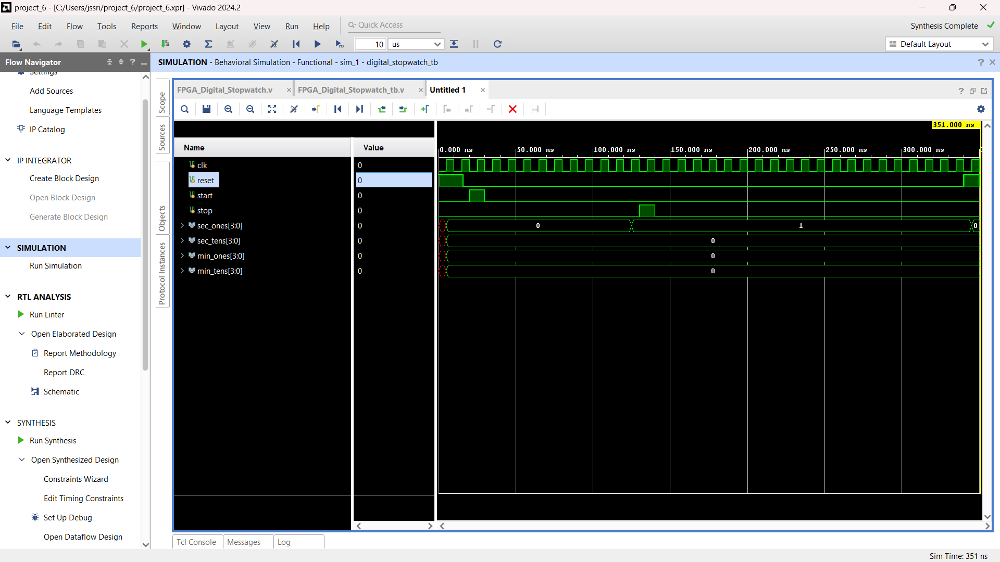
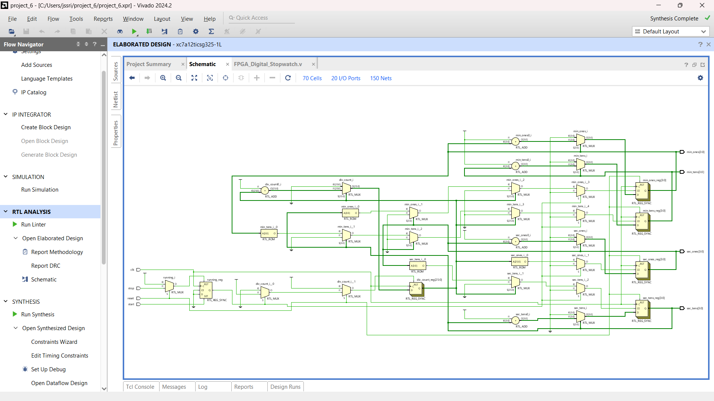
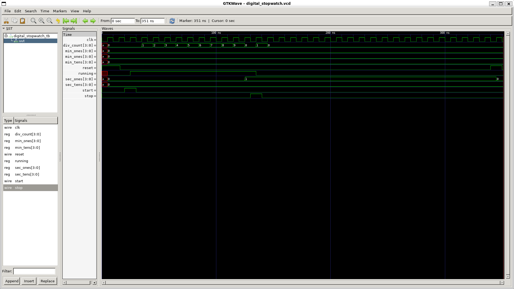

# FPGA-Based Digital Stopwatch

## Project Overview
This project implements a digital stopwatch using Verilog HDL. It supports start, stop, and reset operations and displays elapsed time using four BCD digits.

## Features
- Start, Stop, and Reset controls
- Clock divider for 1-second timing
- Seconds and minutes counting
- BCD digit representation
- Verilog simulation and waveform verification

## Tools Used
- Verilog HDL
- Xilinx Vivado
- Icarus Verilog
- GTKWave
- Ubuntu Linux

## Project Structure
```text
FPGA_Based_Digital_System/
├── Documentation/
├── RTL_Schematic/
│   └── Stopwatch_RTL_Schematic.png
├── Simulation/
│   ├── Stopwatch_GTKWave_Waveform.png
│   ├── Stopwatch_Vivado_Simulation.png
│   └── digital_stopwatch.vcd
├── Testbench/
│   └── digital_stopwatch_tb.v
└── Verilog/
    └── digital_stopwatch.v
```

## Simulation Results

### Vivado Simulation


### RTL Schematic


### GTKWave Output


## How to Run
Compile:
```bash
iverilog -g2012 -o digital_stopwatch_sim Verilog/digital_stopwatch.v Testbench/digital_stopwatch_tb.v
```

Run:
```bash
vvp digital_stopwatch_sim
```

View waveform:
```bash
gtkwave Simulation/digital_stopwatch.vcd
```

## Author
Jada Shanmukha Srinivas

## Note
The design has been simulated and verified. FPGA board implementation and hardware testing are not claimed in this project.
